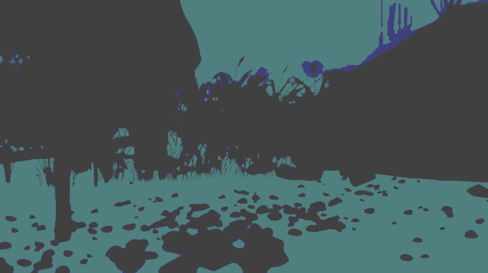

# MGSV: Ground Zeroes NX

Running the Xbox 360 version of Metal Gear Solid V: Ground Zeroes natively on the Nintendo Switch, through static recompilation.

> **Status: archived research project.** It boots, plays audio, takes input and renders lit 3D scenes, but it is **not playable** (around 2 fps on the console, with lots of rendering glitches).

**No game content is included.** You need your own legally obtained copy of the game. This repository only holds build files, my own source changes, tools and documentation.

# Navigation

- [Why?](#why)
- [How it works](#how-it-works)
- [Status](#status)
- [What I found](#what-i-found)
- [Roadmap](#roadmap)
- [Repository Contents](#repository-contents)
- [Building](#building)
- [Credits](#credits)
- [License](#license)
- [Contact](#contact)
- [Support](#support)

# Why?

I saw someone installing lots of community ports on a Switch Lite, and one of them was an unofficial port of Metal Gear Rising: Revengeance, the Xbox 360 version, running natively on the Switch. So I thought: if Rising works, why not Ground Zeroes? :)

It turned out to be a lot harder. Rising and Ground Zeroes are both Xbox 360 games, but Ground Zeroes runs on Fox Engine, which pushes the Xbox 360 really hard: deferred lighting, stencil light volumes, gamma render targets, 3D colour grading tables, tiled rendering and lots of memory tricks between render targets. Every one of those needs to be handled correctly before the picture looks right.

I got it to boot on real hardware and draw real 3D scenes, but making it playable would take months of work, so I'm archiving it here as a research project. Maybe it helps someone porting another Xbox 360 game!

# How it works

**CPU: static recompilation.** [ReXGlue](https://github.com/rexglue/rexglue-sdk) translates the game's PowerPC executable (`default.xex`) ahead of time into C++, which is then compiled for the target (macOS arm64 or Switch arm64). This is **not** decompilation and **not** a source port: Fox Engine's source code was never available.

**GPU: two paths.**
 - **Emulated GPU** (the SDK's Xenia-derived Xenos emulation on Vulkan)
	 - Pros:
		 - Renders the game correctly.
	 - Cons:
		 - Around 4-6 fps on the Switch.
		 - 10-20 minute first boot (shader compilation).
 - **Native renderer** (`nx/src/me`, based on the [sa2-nx](https://github.com/ChanseyIsTheBest/sa2-nx) port)
	 - Pros:
		 - Boots in about 1 minute.
		 - Precompiled shaders, no in-game compilation.
	 - Cons:
		 - Correctness is incomplete (see [What I found](#what-i-found)).
		 - Around 2 fps on the Switch for now.

**Switch:** [devkitPro](https://devkitpro.org/) / libnx, with Mesa NVK as the Vulkan driver, packaged as an `.nro`.

# Status

| | macOS (MoltenVK) | Switch (NVK) |
|---|---|---|
| Boot, audio, input | ✅ | ✅ (~1 min boot) |
| Title screen 3D | ✅ lit, close to the emulated reference | ⚠️ rendered, glitchy |
| Cutscenes / first mission | ⚠️ lit 3D, some flat polygons, banded lens-flare streaks, colour noise | ⚠️ heavy glitches |
| Speed | — | ~2 fps (native), ~4-6 fps (emulated) |

# What I found

Every bug that made the native renderer draw black or wrong images, with its root cause, is written up in [docs/FINDINGS.md](docs/FINDINGS.md). The highlights:

**Pixel position bug:** fullscreen passes read the pixel position from the wrong register, so the depth restore wrote "far away" everywhere and all deferred lighting went black.
**3D colour grading table:** the game renders its grading table as a 2D image and reads it back as a 3D texture; it's now rebuilt on the GPU.
**Gamma render targets:** stored linear instead of gamma-encoded, so cutscenes were about 2x too dark.
**Shader variants:** Direct3D rewrites vertex shaders per vertex layout; those copies are now captured and rebuilt (`nx/tools/repair_vs_variants.py`).
**Garbage shaders:** shaders captured from reused memory, now filtered out.
**Partial vertices:** the last vertex of some vertex buffers was dropped, stretching triangles across the screen.

# Roadmap

 - [x] Recompile the game and run it on macOS (emulated GPU)
 - [x] Fix the 1/64 brightness bug in the SDK's shader translator
 - [x] Build the Switch toolchain, NVK and `.nro` packaging
 - [x] Boot on a real Switch (emulated GPU, then native renderer)
 - [x] Native renderer: lit 3D on the title screen and first cutscenes
 - [ ] Fix the remaining flat polygons, lens-flare streaks and colour noise
 - [ ] Get it playable on the Switch (needs months of performance work)

# Repository Contents

- [nx/](nx) -> the Switch & macOS app project (manifest, CMake, app source and the native renderer)
- [nx/tools/](nx/tools) -> NVK build for macOS, SD card packaging, FTP push / log fetch, Mac test runner, shader variant repair
- [port/](port) -> the earlier macOS-only build on the emulated GPU, and the SDK patch it needs
- [patches/sa2-nx/](patches/sa2-nx) -> my fixes to sa2-nx's shader translator (apply on `BASE_COMMIT`) and the macOS shader library build script
- [tools/](tools) -> XEX inspection & extraction helpers (the retail XEX key is **not** included, set `XEX_RETAIL_KEY` yourself)
- [docs/](docs) -> findings, plus the original porting assessment

# Building

These steps are a record of how I built it, not a polished build system, so expect to adapt some paths.

1. Extract your own disc to `extracted/` (with `default.xex`).
2. Get the [ReXGlue SDK](https://github.com/rexglue/rexglue-sdk) and the [sa2-nx](https://github.com/ChanseyIsTheBest/sa2-nx) Switch fork, then apply `patches/sa2-nx/*.patch`.
3. Generate the recompiled code with ReXGlue from `nx/mgsv_gz_manifest.toml`, then configure `nx/` with CMake for macOS, or with devkitPro for the Switch.
4. Dump the game's shaders with a run (`--mgsv_dump_shaders=true`) and build the native shader library with `patches/sa2-nx/build_shader_library_mac.sh` (needs DXC).
5. `nx/tools/package_sd.sh` assembles the SD card folder, and `nx/tools/switch_ftp.sh` sends it over FTP.

# Credits

- [ReXGlue SDK](https://github.com/rexglue/rexglue-sdk) by Tom Clay (portions from the [Xenia](https://github.com/xenia-project/xenia) project)
- [sa2-nx](https://github.com/ChanseyIsTheBest/sa2-nx) and [sc5p2-nx](https://github.com/TopTools69/sc5p2-nx): the Switch layer, native renderer and XenosRecomp fork this project is built on
- [nfsmw-nx](https://github.com/StevensND/nfsmw-nx) as a reference port
- [Mesa NVK](https://docs.mesa3d.org/drivers/nvk.html), [devkitPro / libnx](https://devkitpro.org/)

# License

Because it contains and modifies GPL-3.0 code, this repository is licensed under the [GNU GPL v3](LICENSE).

Metal Gear Solid V: Ground Zeroes is © Konami Digital Entertainment. This project is not affiliated with or endorsed by Konami or Nintendo.

# Contact

You can contact me using [yusuf@tachion.tech](mailto:yusuf@tachion.tech)

# Support

You can support me using ["Buy Me A Coffee"](https://buymeacoffee.com/myusuf)!
